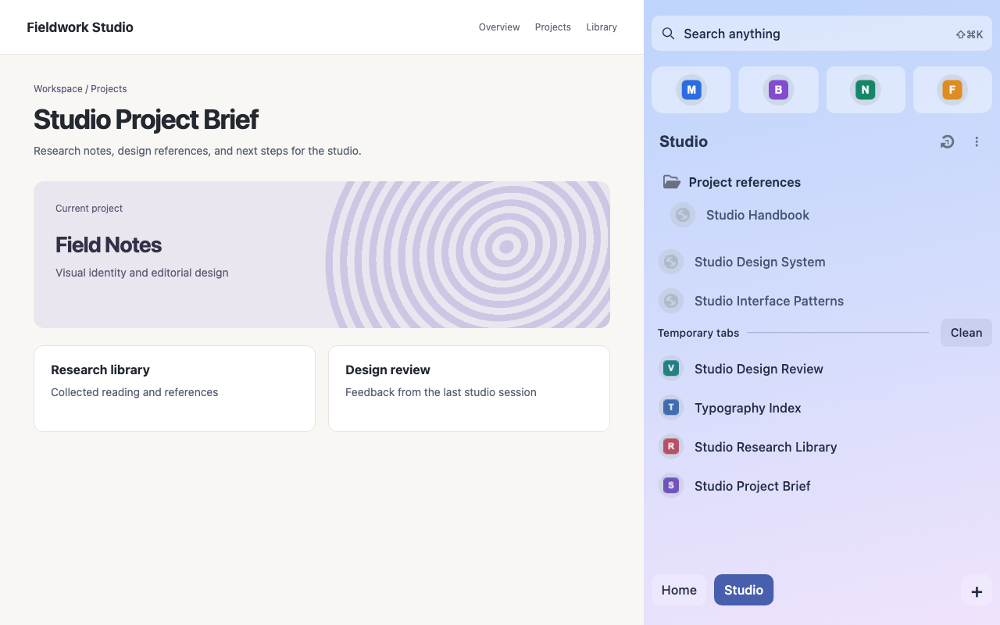
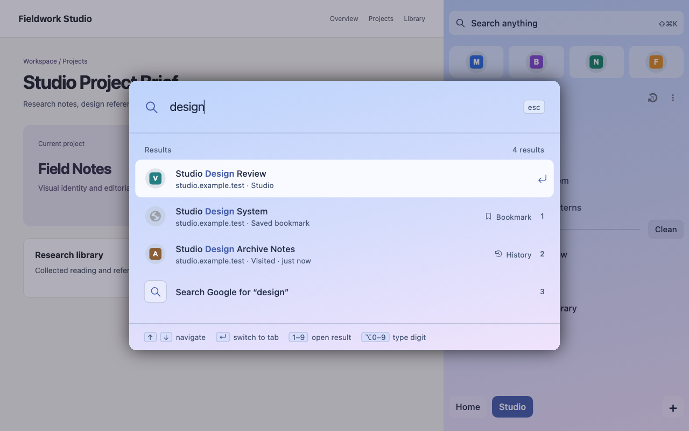
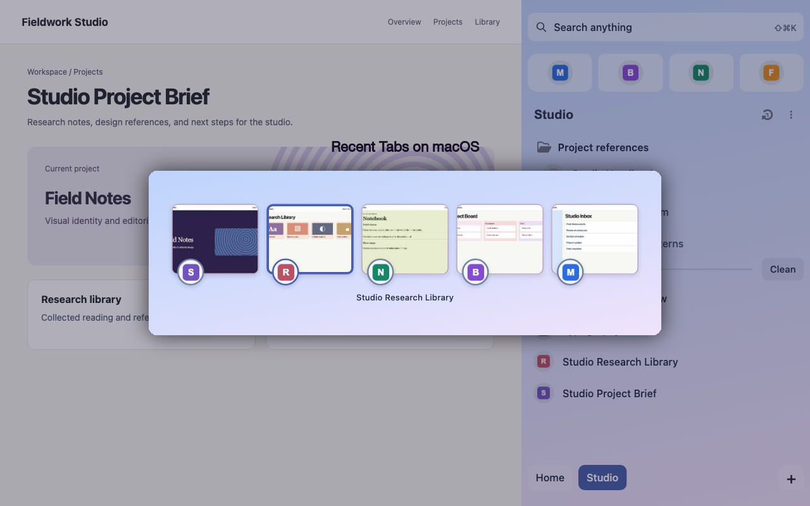

<p align="center">
  
</p>

<h1 align="center">PrismArc</h1>

<p align="center"><strong>A vertical tab sidebar for Chrome</strong></p>

<p align="center">
  Give each project a Space, keep important pages pinned, and find tabs, bookmarks, and history from one search box.
</p>

<p align="center">
  <a href="#install-prismarc"><strong>Install PrismArc</strong></a> ·
  <a href="#first-steps">First steps</a> ·
  <a href="#privacy">Privacy</a>
</p>



## Make the sidebar your own

- **Organize with Spaces.** Give work, personal browsing, or a project its own list of tabs. Drag tabs between Spaces and give each Space a color.
- **Route tabs with Air Traffic.** In **Settings → Air Traffic**, add a URL pattern, choose a destination Space, and save. Use `example.com/*` for the whole site or `example.com/projects` for an exact path. PrismArc checks rules from top to bottom when a temporary tab opens or navigates.
- **Keep useful pages within reach.** Add frequently used pages to Favorites at the top. Pin project links inside a Space and group them into folders. Space pins are saved as Chrome bookmarks.
- **Clear out old tabs.** Use **Clean** to preview which temporary tabs will close and undo a cleanup if needed. Turn on **Auto-archive** to close idle tabs and restore them later from **Archived Tabs**.

## Get back to the right page

| Quick Switcher | Recent Tabs on macOS |
| --- | --- |
| [](assets/readme-quick-switcher.png) | [](assets/readme-recent-tabs.png) |
| Search by title or address, then jump to an open tab or reopen a page. | Return to your previous tab or choose from recently used tabs. Optional thumbnails help you recognize a page. |

<sub>The screenshots show a sample workspace with the optional webpage overlay enabled for both switchers.</sub>

## Install PrismArc

Build and load PrismArc from source. You’ll need **desktop Chrome 116 or newer**, Git, and Node.js **22.13+ on the 22.x line or 24+** with npm.

```sh
git clone https://github.com/eladmoshe/prismarc-public.git
cd prismarc-public
PUPPETEER_SKIP_DOWNLOAD=true npm ci
npm run build:local
```

1. Open `chrome://extensions` and turn on **Developer mode**.
2. Click **Load unpacked** and select the `dist` folder inside `prismarc-public`.
3. Open Chrome’s **Extensions** menu and pin **PrismArc** to the toolbar. Click its icon to open the sidebar.

To update, pull the latest source, run the install and build commands again, then click **Reload** on the PrismArc card in `chrome://extensions`.

## First steps

1. Select **+** beside the Space chips to create a Space. Drag tabs into it and right-click a tab to pin it.
2. Click **Search anything** in the sidebar to try Quick Switcher. Open **Settings → Getting started** to see your assigned shortcuts and practice using them.
3. On macOS, try **Option+A** for **Cycle through open tabs**, or keep **Option+Tab** if it already works. Tap the shortcut to return to your previous tab. Hold **Option** and repeat the shortcut to choose another, then release **Option** to switch.

If a shortcut is missing or conflicts with Chrome, assign it at `chrome://extensions/shortcuts`. The getting-started guide is available anytime from PrismArc Settings.

To give the webpage more room, drag the divider between the sidebar and the page toward the edge of the Chrome window. Chrome sets the minimum width of the sidebar. [Chrome side panel help](https://support.google.com/chrome/answer/13156494)

## Privacy

PrismArc processes tab, bookmark, history, and thumbnail data on your device. The maintainer receives no browsing data or usage analytics. Chrome can sync native bookmarks and history according to your profile settings.

The optional webpage overlay and automatic capture of page previews request additional site access. Manage both and exclude sites from previews in **Settings → Recent Tabs & Quick Switcher**.

[Local build privacy policy](PRIVACY.md) · [Chrome Web Store build privacy policy](PRIVACY-CHROME-WEB-STORE.md)

## Source and license

PrismArc is an independent fork of [Arcify](https://github.com/nisargkolhe/arcify), created by Nisarg Kolhe and maintained by the Arcify contributors. It is distributed under the [GNU GPL v3.0](LICENSE). See the [modification notice](NOTICE) for PrismArc’s changes.

<details>
<summary>Builds and source review</summary>

For a source review, use a link to a specific commit in the [public snapshot repository](https://github.com/eladmoshe/prismarc-public). Run `npm run lint` and `npm run test:unit` after installing dependencies. See the [manifest](manifest.json) for Chrome permissions.

`npm run build:local` also produces `arcify-extension.zip`. The optional Google Calendar preview is available in the local build. `npm run build:chrome-web-store` builds the Calendar-free package in `dist-store/` and creates `prismarc-chrome-web-store.zip`.

</details>
